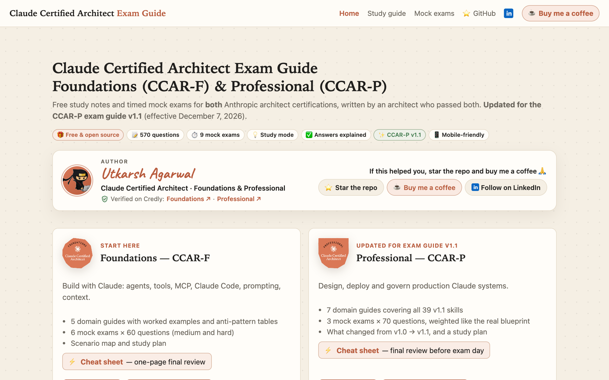
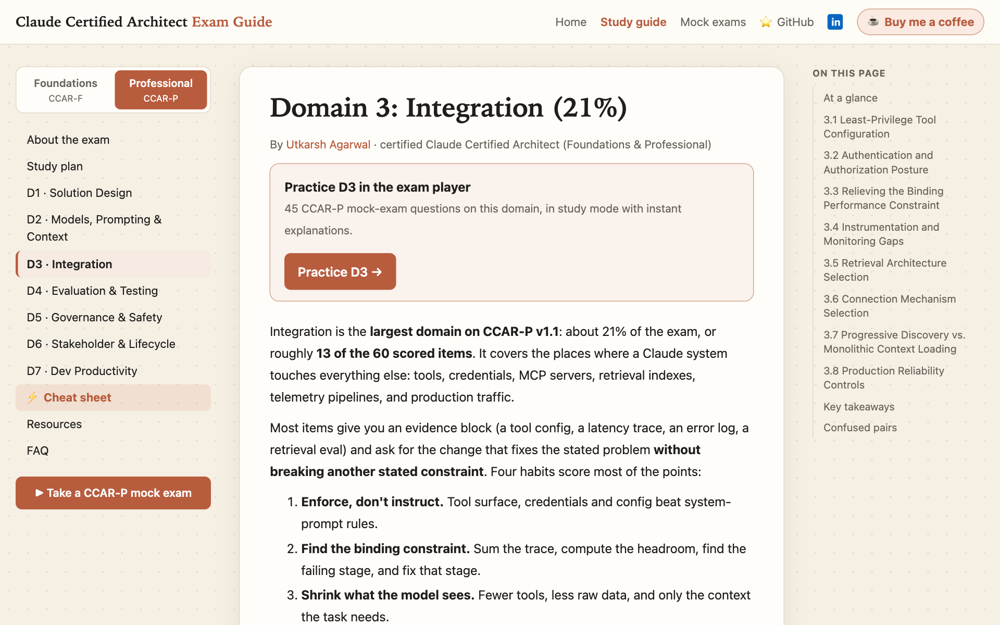
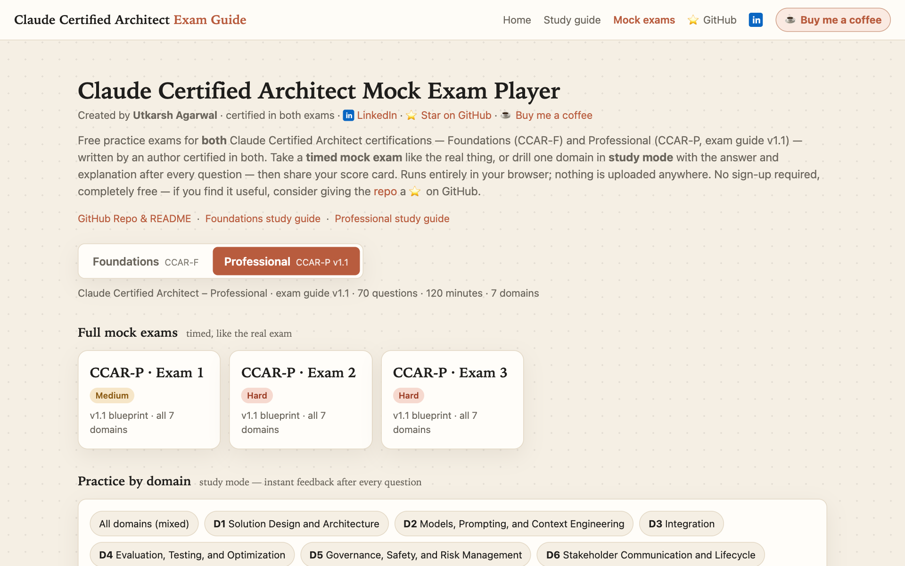
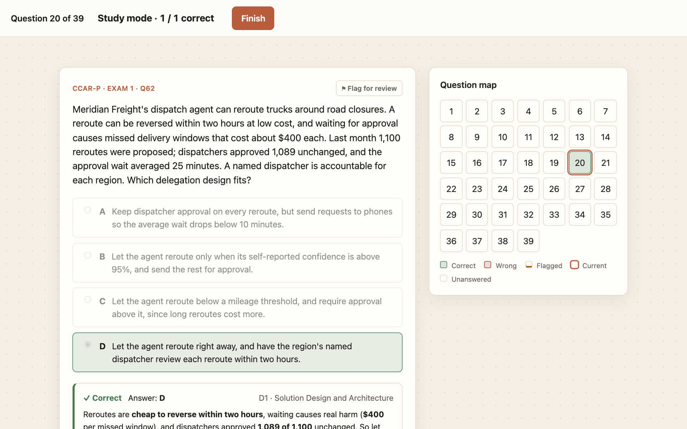

# Claude Certified Architect Exam Guide — Foundations (CCAR-F) & Professional (CCAR-P)

[](https://www.credly.com/badges/bb47f185-1f01-4c2f-adbb-c5401f3c8ce4/public_url)
[](https://www.credly.com/badges/612c2efc-0487-49f5-ab45-3991e8bf2cdc/public_url)


<!-- byline:start -->
<p align="center"><b>Created by Utkarsh Agarwal</b> — certified in both Claude Certified Architect exams<br><a href="https://github.com/utkarsh1agarwal/claude-architect-exam-guide">⭐ Star the repo</a> · <a href="https://www.linkedin.com/in/utkarsh-agarwal-ua0235/">💼 Follow on LinkedIn</a> · <a href="https://utkarsh1agarwal.github.io/claude-architect-exam-guide/#support">☕ Buy me a coffee</a></p>
<!-- byline:end -->

### 🌐 Website: [utkarsh1agarwal.github.io/claude-architect-exam-guide](https://utkarsh1agarwal.github.io/claude-architect-exam-guide/)

**📖 [Read the Study Guide](https://utkarsh1agarwal.github.io/claude-architect-exam-guide/guide/)** · **▶ [Take a Mock Exam](https://utkarsh1agarwal.github.io/claude-architect-exam-guide/mock-exam/interactive/)** · **☕ [Buy me a coffee](https://utkarsh1agarwal.github.io/claude-architect-exam-guide/#support)**

<table>
  <tr>
    <td width="50%"><a href="https://utkarsh1agarwal.github.io/claude-architect-exam-guide/"></a><br><sub><b>Home</b> — pick Foundations or Professional, study guide or mock exam</sub></td>
    <td width="50%"><a href="https://utkarsh1agarwal.github.io/claude-architect-exam-guide/guide/professional/domain-3-integration.html"></a><br><sub><b>Study guide</b> — every domain as a web page, hidden answers, one-click practice</sub></td>
  </tr>
  <tr>
    <td width="50%"><a href="https://utkarsh1agarwal.github.io/claude-architect-exam-guide/mock-exam/interactive/#professional"></a><br><sub><b>Mock exams</b> — timed exams or drill one domain</sub></td>
    <td width="50%"><a href="https://utkarsh1agarwal.github.io/claude-architect-exam-guide/mock-exam/interactive/#professional"></a><br><sub><b>Study mode</b> — the answer and explanation right after each question</sub></td>
  </tr>
</table>

**Free study notes and timed mock exams for both Anthropic architect certifications** — written by an architect who passed **both** the Claude Certified Architect – Foundations ([verify on Credly](https://www.credly.com/badges/bb47f185-1f01-4c2f-adbb-c5401f3c8ce4/public_url)) and the Claude Certified Architect – Professional ([verify on Credly](https://www.credly.com/badges/612c2efc-0487-49f5-ab45-3991e8bf2cdc/public_url)) exams.

| | **Foundations (CCAR-F)** | **Professional (CCAR-P)** |
|---|---|---|
| Study guide | [Read online](https://utkarsh1agarwal.github.io/claude-architect-exam-guide/guide/foundations/about-the-exam.html) · [5 domain guides + cheat sheet](#claude-certified-architect--foundations-ccar-f) | [Read online](https://utkarsh1agarwal.github.io/claude-architect-exam-guide/guide/professional/about-the-exam.html) · [7 domain guides, all 39 v1.1 skills](professional/README.md) |
| Mock exams | 6 × 60 questions (360) | 3 × 70 questions (210) |
| **Take a mock exam now** | **[▶ Start mock exam](https://utkarsh1agarwal.github.io/claude-architect-exam-guide/mock-exam/interactive/)** | **[▶ Start mock exam](https://utkarsh1agarwal.github.io/claude-architect-exam-guide/mock-exam/interactive/#professional)** |
| Exam version covered | Exam guide **v1.1** (effective Nov 2026; same blueprint as v1.0) | Exam guide **v1.1** (effective Dec 7, 2026) |

Everything runs in your browser, with nothing to install and no sign-up.

**[Study guide](https://utkarsh1agarwal.github.io/claude-architect-exam-guide/guide/)** (web version of the notes):

- **Every domain as a web page** — sidebar navigation, "On this page" contents, light/dark mode
- **Practice questions with hidden answers** — test yourself first, then click "Show answer"
- **"Practice this domain"** — one click opens that domain's mock-exam questions in study mode
- **⚡ Cheat sheets** for the last-minute review

**[Mock exam player](https://utkarsh1agarwal.github.io/claude-architect-exam-guide/mock-exam/interactive/)**:

- **Timed mock exams** — countdown timer, question map, flag-for-review, autosave/resume
- **Study mode** — the answer and full explanation right after each question
- **Practice by domain** — drill one domain with questions drawn from every mock exam
- **Results** — per-domain scores, review filters (all / incorrect / flagged), every option explained
- **Shareable score card** — download or post your result to LinkedIn / X

> Every question here is **original**. This repo contains no leaked or reproduced exam content — see [CONTRIBUTING.md](CONTRIBUTING.md#the-one-hard-rule). If it helps you prepare, a ⭐ helps other candidates find it.

---

## Which exam should I take?

| | Foundations (CCAR-F) | Professional (CCAR-P) |
|---|---|---|
| Focus | Building with Claude: agentic loop, tools & MCP, Claude Code, prompting, context | Designing, deploying and governing **production** Claude systems for enterprises |
| Items / time | 60 items (4 of 6 scenarios) / 120 min | 70 items (60 scored + 10 unscored) / 120 min |
| Passing score | 720 / 1000 (scaled) | 720 / 1000 (scaled) |
| Fee | $125 · [Book the exam ↗](https://anthropic-partners.skilljar.com/claude-certified-architect-foundations-certification) | $175 · [Book the exam ↗](https://anthropic-partners.skilljar.com/claude-certified-architect-professional-certification) |
| Prerequisite | None | None formally — but Foundations scope is **assumed knowledge** |
| Who can register | Claude Partner Network members, via Anthropic Partner Academy (no individual sign-up) — see the [certification FAQ](https://anthropic-partners.skilljar.com/page/faq-certifications) | Same |
| Start here | [Read online](https://utkarsh1agarwal.github.io/claude-architect-exam-guide/guide/foundations/about-the-exam.html) · [Foundations ↓](#claude-certified-architect--foundations-ccar-f) | [Read online](https://utkarsh1agarwal.github.io/claude-architect-exam-guide/guide/professional/about-the-exam.html) · [professional/README.md](professional/README.md) |

New to both? Do Foundations first. Its material is assumed knowledge for Professional, and most of it carries over.

---

## Claude Certified Architect – Professional (CCAR-P)

**Updated for exam guide v1.1** (70 items, effective December 7, 2026). v1.1 rebalances the domains, removes named regulations (GDPR/HIPAA/FedRAMP), and adds Managed Agents, deployment surfaces, effort and context lifecycle, reliability controls, judge bias, model migration, plugins and permission modes. See [what changed](professional/study-guide/about-the-exam.md#what-changed-from-v10-to-v11).

📖 **[Read the CCAR-P study guide online](https://utkarsh1agarwal.github.io/claude-architect-exam-guide/guide/professional/about-the-exam.html)** — or browse the Markdown below.

| If you want… | Go to… |
|---|---|
| Format, weights, the 39 skills, v1.0 → v1.1 changes | [About the exam](professional/study-guide/about-the-exam.md) |
| A study plan + how to read a CCAR-P question | [Study plan](professional/study-guide/study-plan.md) |
| Domain notes | [D1 Solution Design](professional/study-guide/domain-1-solution-design.md) · [D2 Models & Context](professional/study-guide/domain-2-models-prompting-context.md) · [D3 Integration](professional/study-guide/domain-3-integration.md) · [D4 Evaluation](professional/study-guide/domain-4-evaluation-testing.md) · [D5 Governance](professional/study-guide/domain-5-governance-safety.md) · [D6 Stakeholder](professional/study-guide/domain-6-stakeholder-lifecycle.md) · [D7 Dev Productivity](professional/study-guide/domain-7-dev-productivity.md) |
| Final review | [Cheat sheet](professional/study-guide/cheat-sheet.md) |
| Mock exams | **[Interactive player](https://utkarsh1agarwal.github.io/claude-architect-exam-guide/mock-exam/interactive/#professional)** · markdown: [Exam 1](professional/mock-exam/exam-1-questions.md) (medium) · [Exam 2](professional/mock-exam/exam-2-questions.md) (hard) · [Exam 3](professional/mock-exam/exam-3-questions.md) (hard) |
| Official docs mapped per domain | [Resources](professional/study-guide/resources.md) · [FAQ](professional/study-guide/faq.md) |

| # | Domain (v1.1) | Weight |
|---|---|---|
| 3 | Integration | 21% |
| 1 | Solution Design and Architecture | 18% |
| 4 | Evaluation, Testing, and Optimization | 17% |
| 5 | Governance, Safety, and Risk Management | 16% |
| 2 | Claude Models, Prompting, and Context Engineering | 13% |
| 7 | Developer Productivity and Operational Enablement | 8% |
| 6 | Stakeholder Communication and Lifecycle Management | 7% |

---

## Claude Certified Architect – Foundations (CCAR-F)

**Updated for the latest exam guide v1.1** (November 2026). v1.1 keeps the v1.0 blueprint — same domains, weights, scenarios and task statements — and updates registration, ID and support policies. Every task statement has its own section with worked examples and practice questions.

📖 **[Read the CCAR-F study guide online](https://utkarsh1agarwal.github.io/claude-architect-exam-guide/guide/foundations/about-the-exam.html)** — or browse the Markdown below.

| If you want… | Go to… |
|---|---|
| The exam basics — cost, format, scoring, retakes | [study-guide/about-the-exam.md](study-guide/about-the-exam.md) |
| A study plan for how much time you have | [study-guide/study-plan.md](study-guide/study-plan.md) |
| The learning material, one file per domain | [domain-1](study-guide/domain-1-agentic-architecture.md) · [domain-2](study-guide/domain-2-tool-design-mcp.md) · [domain-3](study-guide/domain-3-claude-code-workflows.md) · [domain-4](study-guide/domain-4-prompt-engineering.md) · [domain-5](study-guide/domain-5-context-reliability.md) |
| How the 6 exam scenarios map to domains | [study-guide/scenarios.md](study-guide/scenarios.md) |
| A one-page skim before exam day | [study-guide/cheat-sheet.md](study-guide/cheat-sheet.md) |
| Timed practice questions with an answer key | **[Interactive player](https://utkarsh1agarwal.github.io/claude-architect-exam-guide/mock-exam/interactive/)** — or the markdown: [Exam 1](mock-exam/exam-1-questions.md) (all 6 scenarios) · [Exam 2](mock-exam/exam-2-questions.md) & [Exam 3](mock-exam/exam-3-questions.md) (realistic 4-of-6 draws) · [Exams 4](mock-exam/exam-4-questions.md), [5](mock-exam/exam-5-questions.md) & [6](mock-exam/exam-6-questions.md) (all 6 scenarios each, **hard mode**) |
| The official Anthropic Exam Guide (source of truth) | [Claude Certified Architect – Foundations Exam Guide (PDF)](https://everpath-course-content.s3-accelerate.amazonaws.com/instructor%2F6nizmqk8tpzpfjvt6qmmav7rh%2Fpublic%2F1783542750%2FClaude+Certified+Architect+%E2%80%93+Foundations+Exam+Guide.pdf) |
| Official docs and other resources | [study-guide/resources.md](study-guide/resources.md) · [FAQ](study-guide/faq.md) |

| # | Domain | Weight |
|---|---|---|
| 1 | Agentic Architecture & Orchestration | 27% |
| 3 | Claude Code Configuration & Workflows | 20% |
| 4 | Prompt Engineering & Structured Output | 20% |
| 2 | Tool Design & MCP Integration | 18% |
| 5 | Context Management & Reliability | 15% |

At a glance: 60 scenario-based items · 4 scenarios drawn at random from a bank of 6 · 120 minutes · scaled 720/1000 to pass · $125 · valid 12 months · online proctored or test center.

---

## The one idea that wins both exams

> When a question is about deterministic guarantees — money, identity, ordering, schema compliance, permissions — a **structural or programmatic fix** (a hook, a prerequisite, a schema, a scoped tool, a permission rule) beats a prompt-based fix almost every time. And when something looks broken, the root cause is usually **upstream** of where the symptom shows up.

Professional adds one more: **name the binding constraint first** (latency, budget, residency, irreversibility, an unattended run), then choose the simplest option that respects all of them and is honest about its trade-off.

## Repo structure

```
claude-architect-exam-guide/
├── README.md                ← you are here (both exams)
├── index.html               ← website home page (GitHub Pages)
├── guide/                   ← study guides as web pages (generated — don't edit by hand)
├── study-guide/             ← Foundations (CCAR-F) notes, Markdown source
├── mock-exam/               ← Foundations mock exams (6 × 60)
│   └── interactive/         ← exam player, site styles, theme toggle, Buy me a coffee pop-up
├── professional/            ← Professional (CCAR-P, v1.1)
│   ├── README.md
│   ├── study-guide/         ← about, study plan, 7 domains, cheat sheet, resources, FAQ
│   └── mock-exam/           ← 3 × 70 mock exams + answer keys
├── assets/                  ← screenshots, social preview, badges, fonts, UPI QR code
└── tools/
    ├── build-guide.mjs      ← Markdown → guide/ web pages + sitemap.xml
    ├── update-footers.mjs   ← author byline, support links and header on every page
    └── site.config.json     ← author name, links, avatar, UPI / coffee settings
```

## About the author

I'm certified as both a **Claude Certified Architect – Foundations** ([Credly badge](https://www.credly.com/badges/bb47f185-1f01-4c2f-adbb-c5401f3c8ce4/public_url)) and a **Claude Certified Architect – Professional** ([Credly badge](https://www.credly.com/badges/612c2efc-0487-49f5-ab45-3991e8bf2cdc/public_url)). Connect with me on [LinkedIn](https://www.linkedin.com/in/utkarsh-agarwal-ua0235/) — and if this guide helped you pass, you can [☕ buy me a coffee](https://utkarsh1agarwal.github.io/claude-architect-exam-guide/#support). I wrote these guides while preparing for and passing both exams. Everything is built from Anthropic's public exam guides, the official documentation (fact-checked November 2026), and hands-on work shipping Claude systems.

## Contributing

Corrections, new original practice questions, clearer explanations, and translations are welcome. One hard rule: **no real or leaked exam content, ever.** See [CONTRIBUTING.md](CONTRIBUTING.md).

The Markdown files are the source of truth. After editing notes, regenerate the website pages (Node.js only, no `npm install`):

```bash
node tools/build-guide.mjs      # study guide web pages + sitemap
node tools/update-footers.mjs   # author / support links, if you changed tools/site.config.json
python3 -m http.server 8000     # preview at http://localhost:8000
```

## Disclaimer

Unofficial. The author is certified; this guide isn't. Not affiliated with or reviewed by Anthropic.

"Claude," "Claude Code," and "Claude Certified Architect" are trademarks of Anthropic, PBC. This is an independent, community-maintained study aid — not a substitute for Anthropic's official exam guides, which you should read in full before scheduling. Passing these mock exams does not guarantee passing the real ones.

## License

MIT — see [LICENSE](LICENSE).

<!-- support-footer -->
---

> Created by **Utkarsh Agarwal** — certified Claude Certified Architect (Foundations & Professional).
> Found this useful? [⭐ Star the repo on GitHub](https://github.com/utkarsh1agarwal/claude-architect-exam-guide) · [💼 Follow me on LinkedIn](https://www.linkedin.com/in/utkarsh-agarwal-ua0235/) · [☕ Buy me a coffee](https://utkarsh1agarwal.github.io/claude-architect-exam-guide/#support)
